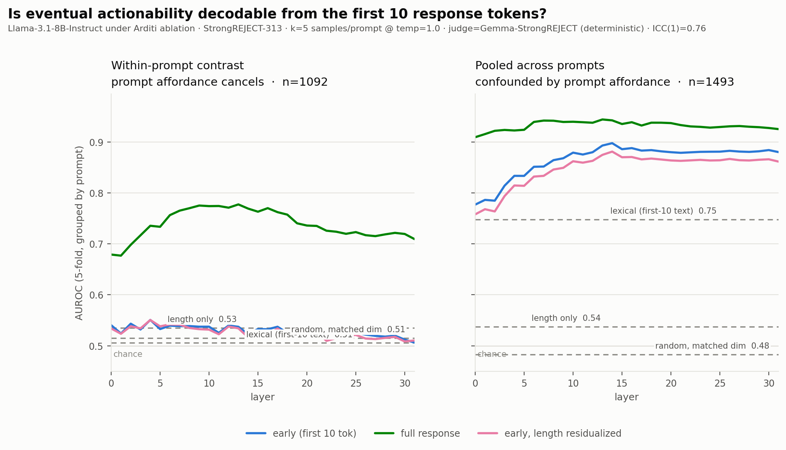

# Early-token decodability of actionability

Seed 1234. n=1525 sampled non-refusal responses over 310 prompts, 32 layers, d=4096.

## Variance gate

```
{
  "n_responses_scored": 1878,
  "n_sampled": 1565,
  "n_after_refusal_drop": 1525,
  "n_prompts_usable": 309,
  "score_mean": 4.2415,
  "score_sd": 0.8064,
  "score_frac_below_3": 0.0801,
  "var_between_prompt": 0.49223,
  "var_within_prompt": 0.15938,
  "icc1": 0.7554,
  "within_sd_median": 0.1674,
  "within_sd_mean": 0.2762,
  "within_range_median": 0.3906,
  "frac_prompts_range_ge_0.3": 0.6052,
  "cap_frac": 0.6502,
  "gate_pass": true,
  "underpowered": [],
  "degenerate": []
}
```

## Peak AUROC by arm

| arm | early (layer) | full (layer) | early_resid (layer) | length | lexical | random | permuted |
|---|---|---|---|---|---|---|---|
| within_prompt | 0.551 (L4) | 0.777 (L13) | 0.551 (L4) | 0.535 | 0.505 | 0.515 | 0.486 |
| pooled | 0.898 (L14) | 0.944 (L13) | 0.881 (L14) | 0.537 | 0.748 | 0.483 | 0.487 |


